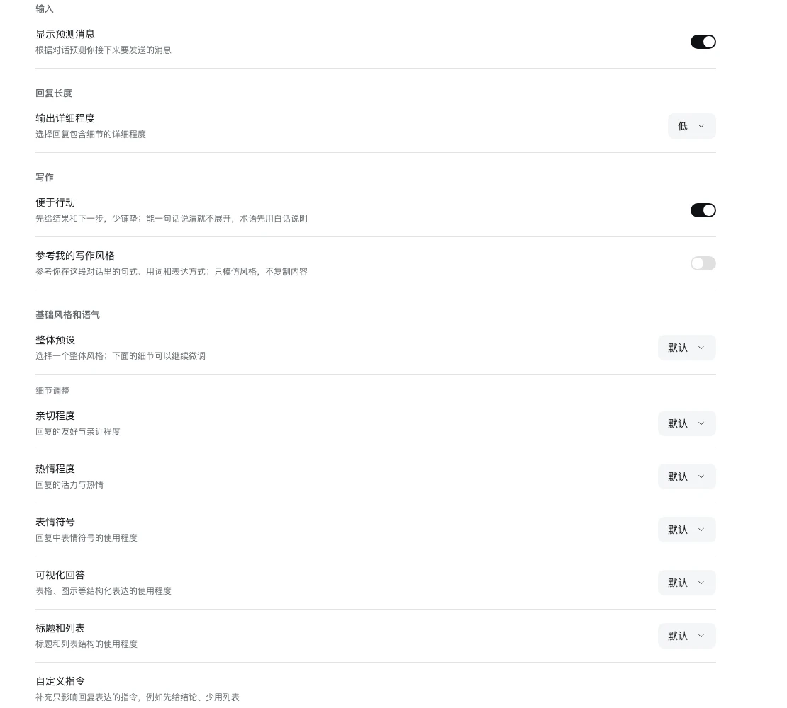

# WDX Relief

WDX Relief reduces the everyday friction of using DeepSeek Harness. Eight features, all configured in the plugin's own settings below the bundle page (**Plugins → Installed plugins → WDX Relief**); nothing is added to the DSH Settings navigation.

## What it does

### Next-message prediction

After a turn, grey text in the composer guesses what you are about to send. Press <kbd>Tab</kbd> to fill it in, keep typing to hide it, or press <kbd>Esc</kbd> to dismiss it. It sends the last few turns to the current default model and caches the result by session sequence; it does not write to the session log.

### The line above the input

A per-turn line that answers "what is this turn doing, and where is it", always above the composer:

- **Live progress** (on by default): after 10 minutes without new output, the line appears automatically with the turn number, latest action and waiting time; from then on it records one progress entry every 10 minutes in Session review. A status chip — running / no output / done / cancelled — keeps it distinct from the finished recap.
- **Semantic recap** (on by default): a cheap model summarizes the latest turn every turn.
- **Activity feed**: generated locally with zero model calls, off by default.

The line never enters the model context; recaps and progress entries are kept in Session review in the WDX Relief panel, starting from the first turn. The "›" at its end opens that tab filtered to progress.

### WDX Relief panel

A right-sidebar page with two tabs, defaulting to Session review (configurable):

- **Session review**: entries grouped by turn, with each turn's progress entries and recap together; the collapsible header shows the turn, counts, end time and turn duration. If any of the last N turns (3 by default, configurable under advanced settings) ends on a question or a "next step / you need" line, the group is marked "Follow up" and the filter can show only those turns. Switch between Newest first and Oldest first; filter by All / Summaries / Progress / Follow up; refresh every 30 seconds; confirm before clearing. Progress entries are derived locally with no model calls.
- **Ask aside**: a composer-style card with its own model picker. The Q&A stays in the panel — not in the session, not in the command log, not in the model context, and it does not change the main session model.

### Reply style

Length **short / standard / detailed** and style **default / professional / friendly / blunt / follow my style**, plus up to 2000 characters of custom instructions. These are prompt-level preferences: they change how a reply is expressed, not the task, the facts, or the tool permissions.

### Action-first

On by default: result and next step first, one sentence when one suffices, while keeping risks, failure conditions, and work you have already authorized.

### ELI5 mode

On by default: injects one line, "talk to me like I'm 5 by default; go deeper when I ask". Turning it off removes that line entirely.

### Tool-call leak guard

When the model writes a tool call as literal text (a `<tool_call>` / `<invoke>` envelope), the step produces no tool card, yet the turn closes as if finished, the guard detects it on the spot and injects a correction in the same turn so the model reissues the call in smaller chunks. The damaged step is voided on the model-visible surface, and a forked session gets a one-time brief telling it not to imitate broken history. At most two automatic corrections per turn by default; it can be disabled or lowered in the plugin settings under "Tool-call guard".

## Install

In the DSH sidebar, go to **Plugins → Add plugin**, enter `dsh-wdx-relief`, then enable it. From a checkout, run `dsh plugin --profile <name> add ./dsh-wdx-relief`.

## Requirements and limits

- DSH Web profile; the plugin depends on the `connection`, `sessions`, and `tools` services.
- A default model must be configured. Prediction, the semantic recap, and Ask aside make model calls; the activity feed, progress entries and the Follow up marker do not. The tool-call guard is zero-cost until it fires, then costs at most one extra model step (bounded by the correction limit).
- Reply style is a soft prompt constraint, not a hard length limit.
- Recaps are stored locally in `$DSH_HOME/wdx-relief/recaps.json` (up to 300 entries); clearing that file clears the history.
- Ask aside keeps answers in panel memory only; closing the panel or switching sessions clears them.
