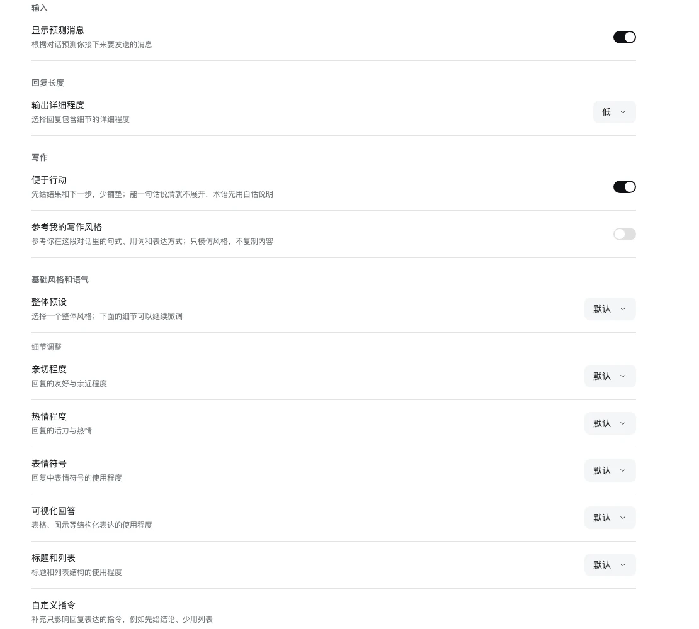

# WDX Relief

WDX Relief 降低 DeepSeek Harness 的日常使用摩擦。八个功能，全部配置在插件自己的设置里（**插件 → 已安装插件 → WDX Relief** 的 bundle 页面下方），不往 DSH 的 Settings 导航里加页面。

## 功能

### 输入框下一句预测

对话结束后，输入框用灰字猜你接下来要发的话。<kbd>Tab</kbd> 填入，继续打字隐藏，<kbd>Esc</kbd> 忽略。它把最近几轮发给当前默认模型，按会话序号缓存结果，不写入会话日志。

### 输入框上的一行

逐轮显示「这一轮在做什么、到哪了」，固定放在输入框上方：

- **实时进度**（默认开启）：一轮运行超过设置的间隔（默认 10 分钟）还没给用户回复时自动出现，显示第几轮、最近动作和等待时长；之后按同一间隔往「会话回顾」记一条进度。工具调用、思考只刷新「无新输出」判断，不算回复，不会重置这个计时。「进行中 / 无新输出 / 已完成 / 已取消」状态条和完成后的摘要用不同样式区分。
- **语义摘要**（默认开启）：每轮用一次便宜模型概括最近一轮；快照与生成都在 Host 的 `turn/end` 上完成，面板没开或切走会话也不会漏。
- **活动流水**：本地生成、零模型调用，默认关闭。

这一行永不进入模型上下文，生成过的摘要和进度记录会留在 WDX Relief 面板的「会话回顾」里；摘要从第 1 轮开始，且每轮结束时由 Host 兜底生成，所以切走会话或关掉面板也不会漏；行尾的「›」直接打开它并筛出进度。

### WDX Relief 页面

右侧栏页面，两个 Tab，默认显示「会话回顾」（可在设置里改成旁问）：

- **会话回顾**：按轮次分组，同一轮的进度记录和摘要放在一起；组头显示轮次、条数、结束时间和这一轮时长，可展开/折叠；最近 N 轮（默认 3，高级设置可改）里如果某轮停在助手提问、或末尾有「下一步 / 需要你」这类待办，组头标「待跟进」，顶部的「待跟进」筛选只看这些轮次。支持「最新在前 / 最早在前」；顶部按「全部 / 摘要 / 进度 / 待跟进」筛选，每 30 秒自动刷新，清空前会再确认一次。进度记录只读本地事件，零模型调用。
- **旁问**：和 composer 一样的圆角卡片，底部可以选旁问专用模型。问答只留在面板里——不写会话、不写命令日志、不进入模型上下文，也不改变主会话模型。

### 回复风格

长度 **短 / 标准 / 详细**，风格 **默认 / 专业 / 亲和 / 直接 / 跟随我的风格**，可加最多 2000 字自定义指令。这些是 prompt 层的偏好：只改变表达方式，不改变任务、事实或工具权限。

### 便于行动

默认开启：先给结果和下一步，能一句说清的不写一段，同时保留风险、失败条件和已授权该做的工作。

### ELI5 模式

默认开启：注入一句「默认用 ELI5 的方式和我说话，如果我要求则深入讲解」。关掉后这句完全不出现。

### 工具调用泄漏守卫

模型把工具调用直接写成正文（`<tool_call>` / `<invoke>` 信封）、这一步没有任何工具卡、turn 却像「已完成」一样结束时，当场检测并在同一轮内注入纠正让模型用小块重发；损坏的那一步会在模型可见面上被作废，fork 出去的会话首步会收到一份简报，提示历史里的坏样本不要模仿。默认最多自动纠正两次，可在插件设置的「工具调用守卫」分组里关闭或调低。

## 安装

在 DSH 侧边栏 **插件 → 添加插件** 输入 `dsh-wdx-relief`，然后启用。从源码安装：`dsh plugin --profile <name> add ./dsh-wdx-relief`。

## 运行要求与限制

- DSH Web profile；插件依赖 `connection`、`sessions` 与 `tools` 服务。
- 需要配置默认模型。预测、语义摘要、旁问会调用模型；活动流水、进度记录和「待跟进」标记不调用。进度记录按设置的间隔（默认 10 分钟）一条，和摘要共用 `$DSH_HOME/wdx-relief/recaps.json`。工具调用守卫平时零开销，触发时最多多一次模型步（受纠正次数上限约束）。
- 回复风格是 prompt 软约束，不是硬性长度截断。
- 摘要存放在本地 `$DSH_HOME/wdx-relief/recaps.json`（最多 300 条）；在面板里点「清空」会同时丢掉当轮缓存，直接删除该文件也能清空历史。
- 旁问回答只存在面板内存里；关闭面板或切换会话即清空。
