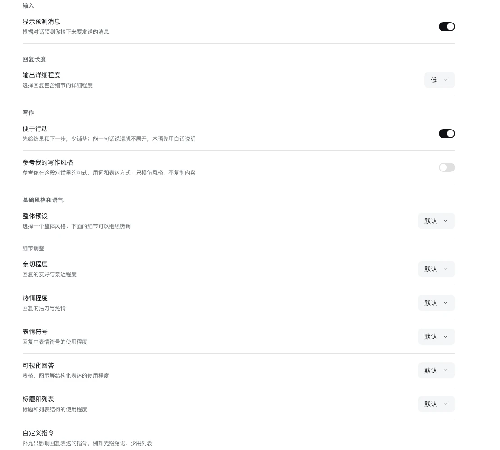

# WDX Relief 开发与验证



> 截图为 0.3.0；0.3.1 起配置页改为「先编辑、再保存」，底部会多出保存按钮。

## 独立 web profile 安装

```bash
export DSH_HOME=/tmp/dsh-relief-dev
dsh web --no-open --port 0          # 首次会生成 profile
dsh plugin --profile web add link:/path/to/dsh-wdx-relief
```

把 `dsh-wdx-relief` 加进 `$DSH_HOME/profiles/web/package.json` 的
`dsh.profile.bundles`（放在 `@deepseek-ai/dsh-web-app` 之后），重启 `dsh web`。

## 配置页在哪里

配置页通过 `ctx.slots.inject('plugins.bundle.config', …)` 注册，key 是包名 `dsh-wdx-relief`；
`dsh.client.inject` 因此声明 `@deepseek-ai/dsh-client-ui-plugin-manager`；同时保留
`@deepseek-ai/dsh-client-ui-settings`（`configForms` 的提供方）和 `@deepseek-ai/dsh-client-ui-sidebar-right`
（右侧栏页面与 `sidebarRightTabs` 的提供方）。插件管理页加载后，bundle 页面在 README 下方渲染这个 keyed slot；插件关闭时
整个浏览器半身卸载，配置页也随之消失。

所有字段都是 Host `Config` 的 `.volatile()` 引用。客户端用
`SettingsFormModel(ctx.configForms.get('wdx-relief'), …)` 暂存编辑，点 **保存** 才通过
`form.mutate()` 写入；离开页面会丢弃未保存草稿。写入落到 profile 的 `cordis.patch.yml`，
HMR 生效。

| 字段 | 默认 | 说明 |
|---|---|---|
| `enabled` | `true` | 输入框预测开关 |
| `recap` | `true` | 语义摘要开关：每轮用一次便宜模型写「现在到哪」 |
| `recapProgress` | `true` | 实时进度开关：按设置的间隔（默认 10 分钟）把一条进度记录合并进「会话回顾」，本地生成 |
| `recapStallSeconds` | `600` | 进度记录间隔（秒），60–3600 |
| `pendingTurns` | `3` | 「待跟进」窗口：最近 N 轮，1–20；高级设置 |
| `recapActivity` | `false` | 活动流水开关：读文件 / 跑命令 / 改代码，本地生成 |
| `recapModelChain` | `''` | 摘要模型链，按顺序尝试 `provider/model`；留空自动挑便宜模型 |
| `defaultTab` | `recaps` | 右侧栏面板默认 Tab：`recaps` / `btw` |
| `verbosity` | `low` | `low` / `medium` / `high`（旧值 `model` 仍兼容） |
| `actionable` | `true` | 便于行动：先结果/下一步、保留风险 |
| `eli5` | `true` | 默认用 ELI5 的方式说话，用户要求时再深入讲解 |
| `style` | `default` | `default` / `professional` / `friendly` / `blunt` / `follow` |
| `customInstructions` | `''` | 最多 2000 字 |
| `toolRepair` | `true` | 工具调用泄漏守卫总开关 |
| `toolRepairLang` | `zh` | 修复提示语言：`zh` / `en` |
| `toolRepairMaxCorrections` | `2` | 每轮最多自动纠正几次；`0` 关闭自动纠正 |
| `toolRepairDebugLog` | `false` | 输出工具调用修复的诊断日志 |

「工具调用守卫」分组顶层只有总开关；修复提示语言、每轮最多纠正次数、诊断日志收进「高级」折叠，改动即时生效。

旧版本的 `writingStyle` / `baseStyle` 仍保留在 schema 里做迁移：没有 `style` 时，`writingStyle: true` 映射为 `follow`，`baseStyle` 的 professional/friendly/blunt 映射到同名风格；设置页只写新的 `style`。

bundle 层只声明入口和输入层的开关，其余字段由 schema 默认值提供：

```yaml
- insert:
    - id: wdx-relief
      name: dsh-wdx-relief
      config:
        enabled: true
        recap: true
        recapProgress: true
        recapStallSeconds: 600
        pendingTurns: 3
        defaultTab: recaps
        toolRepair: true
        toolRepairLang: zh
        toolRepairMaxCorrections: 2
        recapActivity: false
```

## 输入预测

1. 客户端注册在 `conversation.input.overlay`，观察 `useSession.running`、`useInput` 和设置；
   空闲、空输入时以 350ms 防抖请求 `POST /api/wdx-relief/predict`。
2. Host 用 `ctx.sessions.get(sessionId).deriveMessages()` 取最近几轮真人用户/助手文本，
   要求最后一条是助手消息；用 `agentDefaultModel` 的最低推理档位生成一条短句。
   提问框（`ask_user_question`）的问答会还原成「助手（提问）」「用户（回答）」两行：前台回答在
   工具结果的 `{"answers":[…]}` 里，排队回答是 `source.kind === 'user-question-reply'` 的用户消息；
   不还原的话，最近几轮看起来就像助手没问过就把事做完了（例如刚写完 11 条，预测却以为用户还没确认）。
3. 结果按 `session.seq` 缓存；客户端把灰字绝对定位到 `[data-composer-input]` 的文字起点，
   Tab 通过标准 prop `inputActions.setDraft()` 写入 Lexical 编辑器。
   这条 Codex 式体验依赖 composer 的布局矩形，是本插件已知的 DOM 耦合点。

## 输入框上的一行

这一行是**逐轮**的，不是会话级的；它回答「这一轮在做什么、到哪了」。三个开关，默认开实时进度和语义摘要：

| 片段 | 来源 | 成本 |
|---|---|---|
| 实时进度 | `session.binding.eventSource` 里的时间戳与阶段；每 `recapStallSeconds`（默认 600 秒）没给用户回复记一条 | 本地，零调用 |
| 活动流水 | 同一窗口里的 `tool/call`、`tool/result`、步骤事件 | 本地，零调用 |
| 语义摘要 | `POST /api/wdx-relief/recap`，Host 用便宜模型概括最近一轮 | 每轮一次便宜模型 |

状态条把四种情况分开：进行中（蓝色脉冲点）、无新输出（警示色，超过阈值且连事件都没有）、已完成（灰色对勾）、已取消 / 出错 / 已中断。进度记录看的是「距上一次给用户的正文回复多久」：工具调用和思考不会重置这个计时，所以一直跑工具、一直思考也会在 10 分钟时记一条「等待 10 分」。这一行出现后会钉住到本轮结束；状态条仍按实时事件判断，事件恢复后回到「进行中」。普通轮次结束后不会常驻「已完成」：只有生成了语义摘要、开了活动流水、或这一轮曾久到需要提示时才保留完成态。行尾的「›」直接打开右侧栏的「会话回顾」并筛出进度记录。

1. 固定注册在 `conversation.input.dock`（输入框上方），不再提供上下位置选项。
2. 活动流水只读 `ctx.sessions.binding(sessionId).eventSource`；窗口变化时 React
   重算。**不写会话、不写命令日志、不注入 prompt**。
3. 轮次结束后，客户端按 `sessionId + turn` 去重请求一次回顾。Host 只读
   `session.deriveMessages()`，取最近一轮真人用户/助手文本，门限固定为：
   - 从第 1 轮用户消息就开始（`minTurns` 默认 1）；
   - 每轮更新；新摘要与已显示的摘要词集合 Jaccard 相似度 ≥ 0.9 时沿用上一行的文字，但历史仍保留当轮一条；
   - 词预算 40，中文按字、英文按词。
   这些阈值不再作为配置暴露。
4. 模型链先按 `recapModelChain` 里的 `provider/model` 顺序尝试；裸模型 id 会先在默认 provider
   下解析，再查各 provider 的目录。没有配置时，从目录里挑名字带 `flash` / `mini` / `lite` /
   `haiku` 等词的模型，最后退回 `agentDefaultModel.currentSelection()`。某个模型失败（凭据缺失、
   限流、截断）会继续试下一个；全部失败时退回「要求 · 结果」的本地短拼接，并在响应里带
   `degraded: true`。
5. 模型写了半句就停时（没有句末标点，且最后一个分句只剩 1-2 个字，例如
   `…表前缀已替换，待`），先在同一模型上重试一次；仍不完整就截到最后一个分句边界并补省略号。
   流式响应没有 `finish` 事件也按失败处理，继续试下一个模型或退回本地拼接，避免把半句留在面板上。
6. 摘要不再依赖面板在前台：每轮 `turn/end` 时 Host 同步拍下这一轮的消息快照，
   直接调用服务里的 `recapCaptured` 生成摘要；切走会话、关掉面板、
   整页刷新都不会漏。客户端同一刻也在请求时，按轮次内容缓存 + inFlight 合并成一次模型调用。
   子会话（`header.origin === 'subagent'`）跳过，不在会话列表里也不该占一份历史。
7. 摘要按轮次内容缓存；同一条 `(turn, user, assistant, question)` 只生成一次。
   真正生成的新摘要追加到 `$DSH_HOME/wdx-relief/recaps.json`（最多 300 条），
   右侧 WDX Relief 页面的「会话回顾」Tab 通过 `POST /api/wdx-relief/recaps` 读取；
   Tab 顶部显示条数，可「清空」当前会话的历史（body 带 `clear: true`）。
   重复摘要（重启后同一轮重新生成、文字没变）不会再记一条。
8. 运行中每 `recapStallSeconds`（默认 600 秒 = 10 分钟）没给用户回复，客户端把这一轮的轮次、最近动作、
   总耗时和等待时长压成一条进度快照，`POST /api/wdx-relief/progress` 追加到同一份 `recaps.json`。
   同一轮同一档只发一次；Host 再按 `(sessionId, turn, anchor, bucket)` 去重，刷新页面也不会重复。
   进度记录和摘要共用「会话回顾」列表，顶部可按「全部 / 摘要 / 进度」筛选，打开期间每 30 秒静默刷新。

这一行不读工作区文件，也不解释长报告的全部细节；它只概括最近一轮的要求与结果。
语义摘要走 `ctx.llm.stream`，不 append 消息、不进入下一次模型请求。

## 旁问

旁问不再是 composer 命令，而是右侧栏 WDX Relief 页面的「旁问」Tab；面板默认落在「会话回顾」，可在设置里改。

- 输入框和 composer 使用同一套视觉：圆角卡片、底部模型位、右侧圆形发送/停止按钮。按 <kbd>⌘/Ctrl + Enter</kbd> 也可以发送。
- 底部模型位来自会话级模型目录（`ctx.modelDirectories`）。默认跟随当前会话模型；选中别的模型只影响这次旁问，**不会改变主会话模型**。宽度不够时模型名收成数据图标，只保留图标和下拉箭头。
- 客户端调用 `POST /api/wdx-relief/btw`（body: `sessionId` + `question`，可选 `provider` / `model`）。Host 用面板传来的模型；没传时用
  `ctx.agents.get(sessionId).model.current()`，没有实时 agent 时退回默认模型。
- 背景只取 `session.deriveMessages()` 的最近 6 条真人用户/助手文本，限制总长度。
- **不写会话、不写命令生命周期、不 append 消息**：这次问答不会出现在 transcript，也不会进入下一次模型请求。
- 回答仅存在面板内存里，关闭面板或切换会话就清空；正在回答时可以停止，Host 侧超时 30 秒。
- 没有打开会话时显示「先打开一个会话」，不发送请求。
- 如果运行中的 Host 还没加载新路由，面板会提示「旁问路由未加载；请重启 DSH 后再试」，而不是裸露 HTTP 404。

## 右侧栏 WDX Relief 页面

插件在右侧栏注册一个独立页面（`sidebarRightTabs.register`，`kind: wdx-relief`），入口和 WDX Git 一样出现在右侧栏的工具列表（`guide.order 35`）。页面用两个 Tab：「会话回顾」、「旁问」，默认显示「会话回顾」（`defaultTab` 可改为 `btw`）。

### 会话回顾、分组与筛选

- 按轮次分组：同一轮的进度记录和那一轮的摘要放在一组，组头显示「第 N 轮」、进度/摘要条数、结束时间和这一轮时长（如 10:32 · 30 分）。开始时间由进度记录的 `at - elapsedMs` 反推，摘要只能给出结束时间。
- 组可以展开 / 折叠；默认展开最新一轮，点击组头切换。旧记录没有 turn 时归到「更早的记录」。
- 支持「最新在前 / 最早在前」：组和组内记录一起反转；每条记录仍带自己的时间。选「最早在前」时，一轮里的阅读顺序是几次进度在前、摘要收尾。
- 顶部按「全部 / 摘要 / 进度 / 待跟进」筛选，按钮带当前数量；进度行展开显示轮次、总耗时、未回复时长、步数和最近动作。
- **待跟进**：最近 `pendingTurns` 轮（默认 3，1–20，收在设置页「输入框上的一行 → 高级」）里，如果某轮停在助手提问（摘要记录 `kind: question` 或 `question` 非空），或者回复/摘要以「下一步 / 接下来 / 需要你 / 请你 / 等你」开头，组头标「待跟进」，可用「待跟进」筛选只看这些轮次；正在跑的当前轮不标（它还没结束），已经结束的上一轮即使会话在跑也保留标记。判断用的是事件窗口里的**当前轮次**，不是历史里最大的 turn。这个标记只读当前会话的摘要记录，不扫其他会话、不调用模型。
- 打开期间每 30 秒静默刷新一次（不闪骨架屏），也可以手动「刷新」；「清空」会先问一次，确认后删掉当前会话的全部摘要和进度记录。
- 从输入框上方那一行点「›」跳进来时，默认落到「进度」筛选。
- 进度记录纯本地生成，不调用模型；摘要和进度共用同一份历史，最多 300 条。

## 回复风格

Host 在 `ctx.systemPrompt` 注册：

```js
{
  name: 'wdx-relief:reply-style',
  order: 10300,
  interpolate: false,
  text: () => buildStylePrompt(config),
}
```

`buildStylePrompt` 只输出生效项：默认开启的长度、便于行动、ELI5 与风格都会写进 prompt，关掉的项不出现；
开头加一段“只影响表达方式”的说明。自定义指令最多 2000 字；
`interpolate: false` 让其中的 `{{...}}` 保持字面量，避免 prompt 装配报错。

「便于行动」规则改编自 `agent-configs-skills/skills/i-have-adhd`（MIT）：开头给结果/下一步、
按内容比例组织（句 > 段 > 清单）、保留风险与失败条件、不复述、
不把已获授权的工作交回用户。

「ELI5 模式」默认开启，只注入一句「默认用 ELI5 的方式和我说话，如果我要求则深入讲解」；
关掉后这句完全不出现，其余长度、风格、自定义指令不受影响。

## 工具调用泄漏守卫

解决一类静默失败：模型把工具调用**直接写成正文**（`<tool_call>` / `<function=NAME>` / `<parameter=NAME>`，
或 `<invoke>` / `<parameter>`、`antml:` 前缀），这一步没有任何工具卡，agent loop 见 `toolCalls.length === 0`
返回 `{kind:'completed'}`，turn 像「已完成」一样关闭。尤其在 strata 引擎 serve 的模型上出现过：
信封落在正文里，对话直接结束，既不执行也不报错。

实现移植自 `@irwdone/dsh-tool-call-leak-fix`（MIT），并按本插件的 volatile Config 语义改造（每次事件实时读配置）：

- 纯检测核心在 `src/toolCallDetect.js`：零依赖、pure、永不抛错；结构分析前先做影子拷贝，
  剥掉命名空间前缀，并把 strata 方言（`tool_call` → `invoke`、`function` → `parameter`）折成同一种标记，
  所以配对、截断、尾部重复、头部开场等规则复用同一套逻辑。
- 宿主接线在 `src/toolCallRepair.js`，五个机制各挂一个已核实的接缝：
  - **M2** `tools/pre-execute`：分发前扫描参数，尾部结束序列增殖 / 结构截断且体量够大（≥2000 字符或 ≥20 行）
    就拒绝并给出可操作原因；声明了必填参数却收到 `{}` 也拒。
  - **M3** `tools/post-execute`：写入类工具自报空转（`noop:true`、`status:"noop"`、带内容却 `written:0`）时补一条提示。
  - **M4** `session/event` + `agent/turn-stopping`：某步损坏**且**该步没有任何工具调用时，在 turn 即将关闭时
    `agent.inject()` 一条纠正，让 turn 不关闭、同一轮内重发；第一次讲原因并要求小块重试，第二次更硬更短；
    每轮次数由 `toolRepairMaxCorrections` 限制（默认 2），到顶即停。
  - **M7** `agent/pre-step`：fork 会话首步前注入一次简报，把继承来的孤立调用标记标为损坏、不要模仿。
  - **M9** 会话 surface 替换：把损坏那一步在模型可见面上遮蔽成一条说明（日志保留原始事件），零模型调用；
    先用自建探针节点自检 `surfaceOp.replace` 语义，自检失败整个会话故障关闭。
- 消息用生产者自有 source kind（`runtime-context` / `plugin:dsh-wdx-relief`），符合 v4 session 格式。
- 单测：`test/toolCallDetect.test.mjs`（含 strata 样本、JSON 信封、反例）与 `test/toolCallRepair.test.mjs`
  （M2/M3/M4/M7/M9 全链路 mock）。
- 设置页有独立分组「工具调用守卫」：总开关在顶层，修复提示语言、每轮最多纠正次数、诊断日志收在「高级」折叠里；
  客户端表单字段与 `readToolRepairConfig` 读取的键一一对应，保存后 Host 侧下一个事件即按新值生效。

## 实机验证记录（DSH 0.2.2-rc.1，历史配置页）

- 侧边栏「插件」→ **WDX Relief** bundle 页出现配置区：功能开关（预测）、输入框上的一行、回复方式、工具调用守卫；
- 下拉框、开关、textarea 均可写入；关闭再打开设置后保持；`--dump-config` 能看到 `verbosity`、`actionable`、`eli5`、`style`、`customInstructions`；
- Settings 导航不再出现「回复」，General 不再出现预测行（已迁移到插件配置）；
- 输入框灰字出现、打字隐藏、清空重现，Tab 真正写入 Lexical；
- 关闭预测开关后不再发预测请求；
- Host 日志确认预测路由与 `wdx-relief:reply-style` prompt section 注册成功；
- Node 单测通过。


## 0.3.1 验证

- `conversation.input.overlay` 下 `wdx-prediction`（registrant `wdx-relief`，active）；保持 Codex 式输入框灰字。
- `plugins.bundle.config` 下 `dsh-wdx-relief` 条目仍 active。
- 配置页改用 `SettingsFormModel` 暂存、`SettingsForm` 保存；`node --test` 27 项通过。
- `npm pack --dry-run` 确认 `client/client.js`、`locale`、`icon.svg`、`cordis.patch.yml` 都在发布文件里。
- 浏览器内交互（实际点击、保存、开关、Tab）尚未在本次会话中用浏览器控制复核。

## 0.4.0 验证

- Host 日志出现 `POST /api/wdx-relief/recap`、`POST /api/wdx-relief/progress` 与 `POST /api/wdx-relief/btw` 注册；
- 客户端注册面新增 `conversation.input.dock` / `conversation.composer.dock` 的 `wdx-turn-line-*` 与右侧栏 `sidebar.right.pane.tab` 的 `wdx-relief` 页面；
- 面板默认展示「会话回顾」Tab，旁问模型位读取 `ctx.modelDirectories`，选中只影响旁问；
- `node --test` 覆盖回顾提取 / minTurns / cooldown / 相似度门限 / 模型链、旁问提示词/回答/错误/模型覆盖、今日清单、客户端事件推导与注册面；
- 浏览器内实际轮次切换、两种 placement、旁问 Tab 与 Markdown 渲染尚未在本次会话中用浏览器控制复核。

## 已知限制

- 回复风格是 prompt 软约束，不是硬截断；复杂任务仍可能写长。
- 语义摘要依赖一次模型调用；模型失败时退回本地短拼接，且**失败结果不缓存、不写历史**，下一轮会重试。活动流水不受影响。
- 「会话回顾」的摘要和进度记录存在本地 `$DSH_HOME/wdx-relief/recaps.json`，最多 300 条；换机器或清空该文件即清空历史。
- 旁问只把最近几轮文本作为背景；它不会读取工作区文件，也不会自动带上未提交的改动。
- 旁问默认使用当前会话模型，也可以在面板底部选别的模型；选择只影响这一次/这一组旁问，不改主会话模型。
- 没有实时 agent 时退回默认模型，两者都没有时返回面板错误。
- 每次旁问独立：上一次旁问的问答不会成为下一次背景（它们本来就不在会话里）。
- 旁问的回答只存在面板内存里，不跨刷新/重开保留；这是为了不把问答写进任何持久存储。
- 写作风格只看当前对话；没有跨会话风格档案，也不读取工作区文件或外部应用。
- 风格设置全局生效，暂不支持 per-session。
- 工具调用守卫只能缩短故障窗口、把静默失败变成显式失败并在同一轮内重试，改不了模型本身的退化；触发时最多多一次模型步（受 `toolRepairMaxCorrections` 限制）。
- 工具调用守卫平时零开销，但正常引用 `<tool_call>` 字样、且该步没有任何工具调用的解释性回复，理论上可能被判定为泄漏并注入一次纠正（下一事件会立即取消待定记录，不会连续误伤）。
- 灰字定位依赖 composer 的 DOM 属性（`data-composer-card/input/placeholder`），DSH 改版时需要同步。
