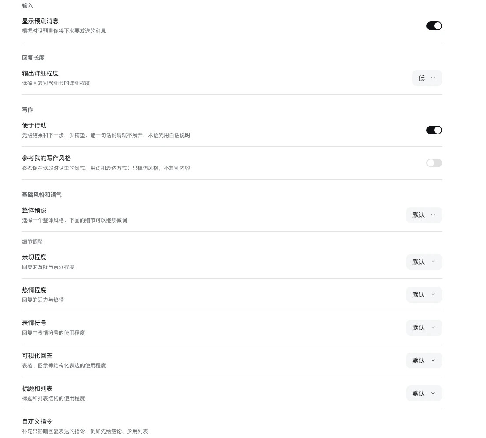

# WDX Relief 开发与验证



## 独立 web profile 安装

```bash
export DSH_HOME=/tmp/dsh-relief-dev
dsh web --no-open --port 0          # 首次会生成 profile
dsh plugin --profile web add link:/path/to/dsh-wdx-relief
```

把 `dsh-wdx-relief` 加进 `$DSH_HOME/profiles/web/package.json` 的
`dsh.profile.bundles`（放在 `@deepseek-ai/dsh-web-app` 之后），重启 `dsh web`。

## 配置页在哪里

`dsh.client.inject` 不依赖 `ui-settings-general` 或 `ui-plugin-manager`；配置页通过
`ctx.slots.inject('plugins.bundle.config', …)` 注册，key 是包名 `dsh-wdx-relief`。
插件管理页加载后，bundle 页面在 README 下方渲染这个 keyed slot；插件关闭时整个浏览器半身卸载，配置页也随之消失。

所有字段都是 Host `Config` 的 `.volatile()` 引用，客户端用 `ctx.configForms.get('wdx-relief')`
读写；写入落到 profile 的 `cordis.patch.yml`，HMR 生效。

| 字段 | 默认 | 说明 |
|---|---|---|
| `enabled` | `true` | 输入框预测开关 |
| `verbosity` | `low` | `model` / `low` / `medium` / `high` |
| `writingStyle` | `false` | 参考当前对话的写作风格 |
| `baseStyle` | `default` | 7 个基础风格预设之一 |
| `friendliness` | `default` | `default` / `enhanced` / `reduced` |
| `enthusiasm` | `default` | 同上 |
| `emoji` | `default` | 同上 |
| `visualAnswers` | `default` | 同上 |
| `headingsLists` | `default` | 同上 |
| `customInstructions` | `''` | 最多 2000 字 |

bundle 层只声明入口和预测开关，其余字段由 schema 默认值提供：

```yaml
- insert:
    - id: wdx-relief
      name: dsh-wdx-relief
      config:
        enabled: true
```

## 输入预测

1. 客户端在 `conversation.input.overlay` 里观察 `useSession.running`、`useInput` 和设置；
   空闲、空输入时以 350ms 防抖请求 `POST /api/wdx-relief/predict`。
2. Host 用 `ctx.sessions.get(sessionId).deriveMessages()` 取最近几轮真人用户/助手文本，
   要求最后一条是助手消息；用 `agentDefaultModel` 的最低推理档位生成一条短句。
3. 结果按 `session.seq` 缓存；客户端把灰字绝对定位到 `[data-composer-input]` 的文字起点，
   Tab 通过标准 prop `inputActions.setDraft()` 写入 Lexical 编辑器。

## 回复风格

Host 在 `ctx.systemPrompt` 注册：

```js
{
  name: 'wdx-relief:reply-style',
  order: 10300,
  interpolate: false,
  text: () => buildStylePrompt(config),
}
```

`buildStylePrompt` 只输出非默认项，并加一段“只影响表达方式”的前缀。自定义指令最多 2000 字；
`interpolate: false` 让其中的 `{{...}}` 保持字面量，避免 prompt 装配报错。

## 实机验证记录（DSH 0.2.2-rc.1）

- 侧边栏「插件」→ **WDX Relief** bundle 页出现配置区：输入开关、回复长度、写作风格、基础风格、五个语气轴、自定义指令；
- 下拉框、开关、textarea 均可写入；关闭再打开设置后保持；`--dump-config` 能看到 `verbosity`、`writingStyle`、`baseStyle`、`customInstructions`；
- Settings 导航不再出现「回复」，General 不再出现预测行（已迁移到插件配置）；
- 输入框灰字出现、打字隐藏、清空重现，Tab 真正写入 Lexical；
- 关闭预测开关后不再发预测请求；
- Host 日志确认预测路由与 `wdx-relief:reply-style` prompt section 注册成功；
- 25 个 Node 单测通过。

## 已知限制

- 回复风格是 prompt 软约束，不是硬截断；复杂任务仍可能写长。
- 写作风格只看当前对话；没有跨会话风格档案，也不读取工作区文件或外部应用。
- 风格设置全局生效，暂不支持 per-session。
- 灰字定位依赖 composer 的 DOM 属性，DSH 改版时需要同步。
